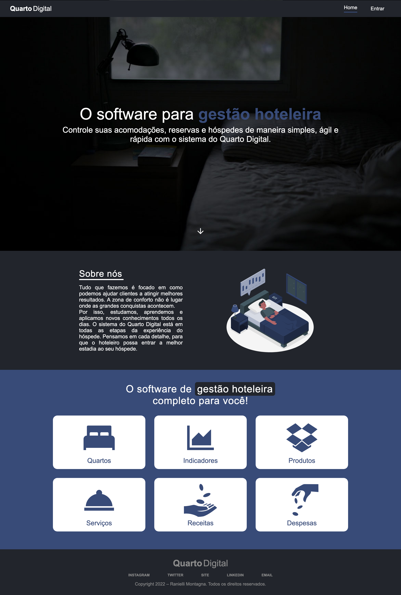
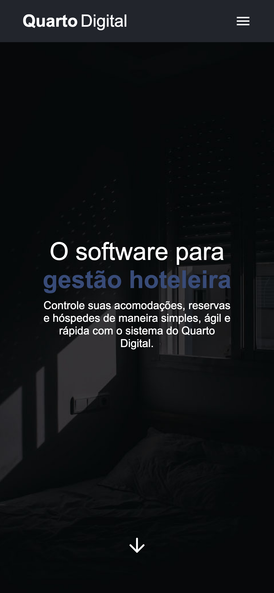

<div align="center">

<picture>
  <source media="(prefers-color-scheme: dark)" srcset="public/static/logo/logoSimplificadoBranco.svg" />
  
</picture>

# Quarto Digital · Landing page

**Marketing site for Quarto Digital, the hotel management system I built as my final project for the Systems Analysis and Development degree at UPF.**


</div>

> [!WARNING]
> **Discontinued.** Quarto Digital is no longer maintained and this repository is archived as a portfolio reference. The site used to live at quarto.digital, which is offline.

Quarto Digital is split into three repositories:

| Repository | What it is |
| --- | --- |
| **landing-page-quarto-digital** (this one) | The marketing site |
| [app-quarto-digital](https://github.com/RanielliMontagna/app-quarto-digital) | The React app the hotel staff uses: rooms, stays, guests, products, services and indicators |
| [api-quarto-digital](https://github.com/RanielliMontagna/api-quarto-digital) | Express + Prisma REST API with JWT auth, PostgreSQL and Swagger docs |

## The page

A single dark page in Portuguese: a full-screen hero, an "about us" section, a grid with the six areas the product covers (rooms, indicators, products, services, revenue and expenses) and a footer with social links. The "Entrar" button opened the app at app.quarto.digital. Expenses were planned but never got a screen in the app.

<table>
  <tr>
    <td width="72%"></td>
    <td width="28%"></td>
  </tr>
</table>

- Smooth scrolling between sections with react-scroll and reveal animations with AOS.
- Responsive menu; unknown routes go back to the home page.
- Sentry error tracking.

## Tech stack

| Area | Tools |
| --- | --- |
| UI | React 17, TypeScript, styled-components, styled-system, MUI 5, React Icons |
| Effects | AOS, react-scroll |
| Build | Create React App 4 (react-scripts 4.0.3), Yarn 1 |
| Monitoring | Sentry |

## Running locally

Last checked in October 2026. Create React App 4 needs Node.js 16 to start.

```bash
git clone https://github.com/RanielliMontagna/landing-page-quarto-digital.git
cd landing-page-quarto-digital
npx yarn@1 install --frozen-lockfile --ignore-engines
nvm use 16              # or: fnm use 16
npx react-scripts start # http://localhost:3000
```

## Project history

- **January–March 2022**: this repository started as the whole Quarto Digital front end: routes, themes, app bar, drawer, sign-in screen, Redux state, a typography and button kit, and the first version of the landing page with the about section and the footer.
- **June 2022**: the app moved to [its own repository](https://github.com/RanielliMontagna/app-quarto-digital) and this one kept only the landing page, now dark only, with smooth scrolling and animations.
- **July–November 2022**: small fixes, the contact page removed and the README updated.
- **October 2026**: archived.

## Author

Built by [Ranielli Montagna](https://github.com/RanielliMontagna) · [ranimontagna.com](https://ranimontagna.com)
